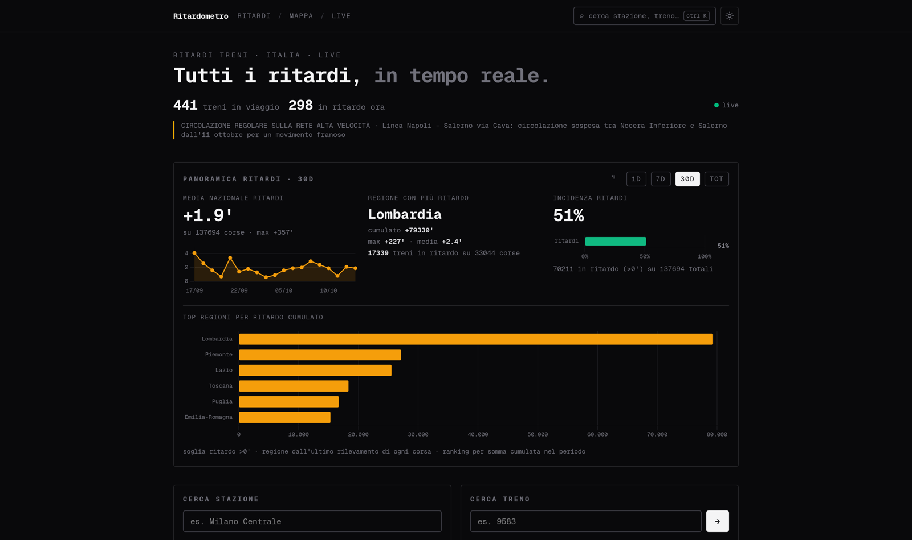
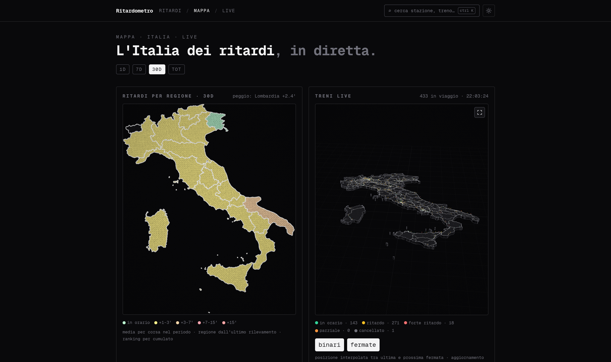
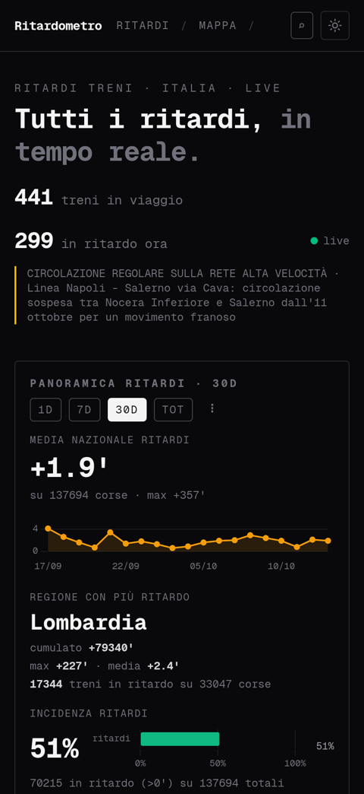

<div align="center">

# Ritardometro

**La rete ferroviaria italiana, in tempo reale.**
*Every Italian train delay, on one live, no-login board.*

[**→ train-monitor-v2.vercel.app**](https://train-monitor-v2.vercel.app)




</div>

## Why

Italy's trains are notoriously opaque. The data exists — RFI publishes it through
**ViaggiaTreno** — but it's spread across a slow, per-station interface that makes
it hard to answer the only questions that matter: *Is my train late? How late is
the network right now? Which region is worst?*

Ritardometro turns that feed into a single live board: national counters, a 3D map
of every circulating train, regional rankings, station boards and per-train history —
**no account, no ads, always live.**

## What it does

- **Live dashboard** — trains in circulation, how many are late *right now*, the
  worst current delays, and the national infomobility ticker.
- **3D live map** — every circulating train drawn on a WebGL map of the Italian
  rail network, position interpolated between its last and next stop, coloured by
  delay. ([screenshot](docs/screenshot-map.png))
- **Region choropleth + ranking** — 30d / 7d / 1d / all-time delay per region.
- **National stats** — average delay, worst region, delay incidence, delay trend.
- **Station boards** — arrivals/departures for 260 major stations + 30-day history.
- **Train detail** — live delay, full stop list, and per-stop history.
- **Real-time, not refreshed** — a single SSE stream pushes changes as they happen.

## Screenshots

| Live map | Mobile |
|---|---|
|  |  |

## How it works

```
ViaggiaTreno API
      │  (polls: live trains every 40s, discovery every 5m)
      ▼
Go poller ───────────► PostgreSQL (Neon)
  tiered scheduler         │  train_runs · stops · daily_* rollups
  change-only writes       ▼
                    SolidStart app (Vercel) ──SSE──► browser
```

Two deployables share one `DATABASE_URL`:

1. **Web** (`apps/web`) — SolidStart SSR app on Vercel. **Never** calls ViaggiaTreno
   directly; it only reads Postgres.
2. **Poller** (`services/poller`) — a Go ingester on its own always-on host. It
   discovers runs, refreshes only those in their live window, and only rewrites a
   run when its delay actually changed.

## Tech stack

| Layer | Stack |
|---|---|
| Web | SolidStart 2 / SolidJS 1.9, Vite 8, Nitro, Tailwind v4, Kobalte, Chart.js, Three.js |
| Data access | Drizzle ORM + `@neondatabase/serverless` (HTTP driver) |
| Ingest | Go 1.24 (`pgx/v5`), tiered scheduler, 25 concurrent workers |
| Database | PostgreSQL (Neon) |

## Repository layout

| Path | What |
|---|---|
| `apps/web/` | SolidStart app (pages, API routes, 3D map, charts) — see [`apps/web/README.md`](apps/web/README.md) |
| `services/poller/` | Go ingester: discovery → detail → store → rollup — see [`services/poller/README.md`](services/poller/README.md) |
| `docs/` | Screenshots |
| `.env.example` | Combined env template (`DATABASE_URL` + poller vars) |

## Getting started

Requires Node ≥ 24, pnpm 10.13.1, Go ≥ 1.24, and a Postgres database.

```bash
cp .env.example .env   # set DATABASE_URL

# --- web ---
pnpm install
pnpm db:push           # create tables (drizzle, dev)
pnpm dev

# --- poller (another shell) ---
for f in 001_schema 004_majors 009_rfi_topup 005_drop_snapshots 006_daily_train_stats 007_daily_train_names 008_daily_train_stats_id; do
  psql $DATABASE_URL -f services/poller/migrations/$f.sql   # fresh install
done
pnpm poller:seed       # all stations from elencoStazioni (never touches is_major)
pnpm poller:run        # tiered scheduler: live trains every 40s, discovery every 5m
```

| Script | What |
|---|---|
| `pnpm dev` / `build` / `start` / `preview` | proxy to `apps/web` (`vite dev` / `vite build` → `node apps/web/.output/server/index.mjs`) |
| `pnpm db:push` | push `apps/web/src/db/schema.ts` (dev) |
| `pnpm db:generate` / `db:migrate` / `db:studio` | generate/migrate/inspect (prod uses migrate) |
| `pnpm poller:run` / `poller:seed` | `go run ./cmd/poller` / `./cmd/seed` in `services/poller` |
| `pnpm poller:vet` / `poller:build` | `go vet ./...` / build binary to `bin/poller` |

## Configuration

| Var | Default | Meaning |
|---|---|---|
| `DATABASE_URL` | — | Postgres connection string (required, shared; on Neon use the pooled string) |
| `ACTIVE_INTERVAL_SECONDS` | `40` | Refresh live trains; changed runs only (`POLL_INTERVAL_SECONDS` deprecated alias) |
| `DISCOVERY_INTERVAL_SECONDS` | `300` | Board sweep for new trains (known runs skipped) |
| `ROLLUP_INTERVAL_SECONDS` | `600` | Fold today's data into `daily_*` aggregates |
| `WORKERS` | `25` | Max concurrent ViaggiaTreno requests |
| `MAJORS_ONLY` | `true` | Poll only `is_major` stations; `false` sweeps all seeded stations |

Web lookup order: `apps/web/.env`, then repo-root `.env`, then launcher CWD
(`src/server/db.ts`). Poller: `services/poller/.env`, then repo-root `.env`.

## Design notes

**Two definitions, one truth.** The DDL source of truth is
`services/poller/migrations/*.sql`; `apps/web/src/db/schema.ts` is a read-only
Drizzle mirror. Any table change = a new migration *plus* a manual mirror update —
the two are never allowed to drift.

**Change-only writes.** The poller rewrites a run only when `ritardo` /
`provvedimento` / `oraUltimoRilevamento` changed, so the hot 40s cadence stays
cheap and static schedule data is never churned. `204` (cancelled) responses are
skipped, not errors.

**Push, don't poll (in the browser).** The client subscribes to a single SSE
endpoint; the server diffs against the last snapshot and pushes only changes
(or a heartbeat). No client polling.

**Degraded mode.** Without `DATABASE_URL` the app still renders: station search
falls back to the seeded Tier-1 list and dashboards show banners instead of
failing.

See [`apps/web/README.md`](apps/web/README.md) for the stats model, route/API
table and responsive layout notes, and [`services/poller/README.md`](services/poller/README.md)
for the pipeline and retention details.

## Deployment

- **Web → Vercel.** Project Root Directory `apps/web`, `NITRO_PRESET=vercel`,
  Node.js 24.x, `DATABASE_URL` via the Neon Marketplace integration. Ignored Build
  Step `git diff --quiet HEAD^ HEAD -- apps/web/` skips poller-only commits.
- **Poller → separate always-on host** (Vercel can't run the ingest loop):

  ```bash
  pnpm build && pnpm start        # web self-hosted alt
  pnpm poller:build && ./bin/poller
  ```

Use `db:migrate` (not `push`) in production.

## License

[MIT](LICENSE). Data from RFI **ViaggiaTreno**; this project is unofficial and not
affiliated with RFI or Trenitalia.
